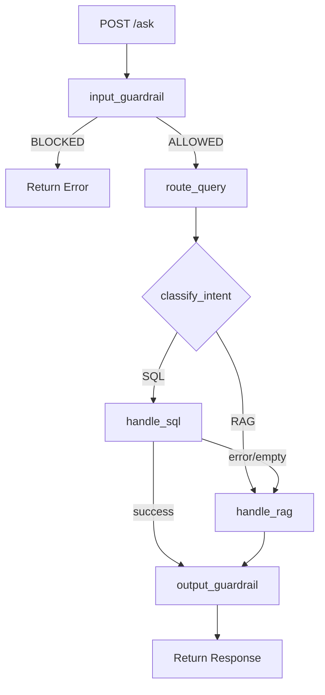

# Kubocare-genai-gpt

This is a health chat bot.

# GenAI IoT Assistant — Full Project Analysis & Recommendations

## Current Architecture



**Stack:**
| Component | Technology |
|-----------|-----------|
| API | FastAPI |
| LLM | Ollama (`qwen2:1.5b`) locally |
| Embeddings | Ollama (`mxbai-embed-large`) |
| DB | PostgreSQL + pgvector |
| Text-to-SQL | Custom planner (JSON plan → safe SQL builder) |
| Vector RAG | pgvector cosine search |
| Memory | ❌ Removed (was a query rewriter) |
| Guardrails | Simple LLM call (input) + heuristic string match (output) |

---

## 🔴 Issue 1: SQL Converter Getting Wrong Answers

### Root Cause Analysis

The SQL pipeline has **4 compounding weak points**:

### (a) Weak Schema Injection in `generate_plan()`

```python
# sql_retriever.py L13-27
# schema_to_text() only sends column NAMES, NOT types!
# Output: "Table: device_status | Columns: board_id, location, signal..."
```

The LLM never sees column types (`TEXT`, `FLOAT`, `TIMESTAMP`), so it guesses
filter values incorrectly (e.g., wrapping a float in quotes, wrong date format).

**Fix:** Send full typed schema like `board_id TEXT, signal FLOAT, time TIMESTAMP`.

### (b) System Prompt and User Prompt Are FIGHTING Each Other

```python
# llm/client.py L70
def ask_llm(query, system_prompt=None):
    sys_prompt = system_prompt if system_prompt else get_system_prompt()
```

`generate_plan()` passes **no system_prompt**, so the default `get_system_prompt()` fires.
BUT `generate_plan()` ALSO injects its own schema + rules into the **user message** (the `prompt` variable in L13-27).

Result: The LLM receives **two conflicting sets of rules and two schemas** — one in system role, one in user role. The `qwen2:1.5b` model (very small, 1.5B params) gets confused and produces inconsistent plans.

**Fix:** Pass the full SQL system prompt from `generate_plan()` directly as the `system_prompt` arg, with only the raw user query in the user message.

### (c) `build_sql()` Drops Columns When `group_by` Is Set

```python
# sql_retriever.py L149-157
if group_by:
    selections.append(group_by)   # ✅ adds group_by col
if agg:
    selections.append(f"{agg.upper()}({col}) as result")  # ✅ adds aggregation
else:
    if not group_by:               # ❌ BUG: if group_by is set, the target col is NEVER added!
        selections.append(col)
```

**Example:** Query `"avg signal by location"` → `SELECT location, AVG(signal) as result` ✅
Query `"signal and cpu by location"` with no agg → `SELECT location` ❌ (cpu and signal are dropped!)

**Fix:**

```python
else:
    selections.append(col)  # Always add the target column, regardless of group_by
```

### (d) `qwen2:1.5b` Is Too Small for Reliable Text-to-SQL

A 1.5B model struggles with multi-condition SQL generation, date arithmetic, and respecting JSON-only output constraints. It hallucinates extra fields, natural language inside JSON, and wrong operator strings.

**Fix options (pick one):**

- Switch to `qwen2.5-coder:7b` or `llama3.1:8b` locally (better JSON discipline)
- Use LangChain's `create_sql_agent` which has battle-tested prompting for this exact task

---

## 🔴 Issue 2: Memory Was Misbehaving

### Why It Broke

The `memory.py` design is fundamentally correct — it's a **query rewriter** pattern, which is the right approach. The problem is in how it was integrated (or not integrated) into `main.py`:

- `main.py` **never calls `rewrite_query_with_memory()`** — memory was never wired in.
- The API endpoint takes `query: str` directly, with **no session_id**, so there's no way to track which user's history to retrieve.
- There was no storage backend — history was never persisted (would reset every call).

**Fix with LangChain:**
`ConversationBufferWindowMemory` + `RunnableWithMessageHistory` gives you:

- Automatic session tracking by `session_id`
- Sliding window (last N turns) to prevent token overflow
- Clean injection into the prompt chain

---

## 🔴 Issue 3: Guardrails Are Too Fragile

### Problems

**Input guardrail:**

- Makes a full LLM call (wasting ~300ms) for a simple intent check on a tiny 1.5B model.
- `qwen2:1.5b` often returns `"ALLOWED"` with extra words like `"ALLOWED - This is a valid IoT query"` — the current code's `"BLOCKED" in decision` check works, but borderline queries pass through inconsistently.

**Output guardrail:**

- Only checks 3 hard-coded `bad_phrases`. This is essentially useless — any real prompt leak or hallucination would use different phrasing.

### Better Approach with LangChain

LangChain lets you plug in structured output parsers + validators:

- **Input**: Use a `PydanticOutputParser` with a `GuardrailDecision` model — forces the LLM to return structured `{decision: "ALLOWED"|"BLOCKED", reason: str}` which is much more reliable to parse.
- **Output**: Use `StrOutputParser` + a custom `RunnableLambda` validator that checks semantic conditions (response is in English, doesn't contain SQL artifacts, has a minimum length, etc.).

---

## Should You Switch to LangChain?

**Short answer: Yes, partially — for the SQL chain and memory. Keep FastAPI and your custom DB layer.**

### What LangChain Gives You Here

| Problem                     | LangChain Solution                                              |
| --------------------------- | --------------------------------------------------------------- |
| SQL converter wrong answers | `SQLDatabaseChain` or `create_sql_agent` with proven prompts    |
| Memory misbehaving          | `RunnableWithMessageHistory` + session management               |
| Guardrails unreliable       | `PydanticOutputParser` for structured decisions                 |
| Retry logic                 | `with_retry()` built into runnables                             |
| Prompt conflicts            | `ChatPromptTemplate` clearly separates system/human/ai messages |

### What to Keep Custom

- `FastAPI` endpoint layer ✅ (LangChain has no opinion here)
- `psycopg2` connection pool in `db.py` ✅ (pass it to LangChain's `SQLDatabase`)
- `vector_retriever.py` ✅ (or replace with `PGVector` from `langchain_community`)
- `logger.py` ✅ (plug in as LangChain callbacks)

### Migration Risk

- Low — LangChain wraps your existing Ollama and Postgres, it doesn't replace them.
- `langchain-ollama` package gives a drop-in `ChatOllama(model="qwen2:1.5b")` LLM object.
- You can migrate **one chain at a time** (start with SQL, leave RAG alone).

---

## Recommended Action Plan

### Phase 1: Fix the SQL bugs NOW (no new deps needed)

1. Fix `build_sql()` — the column-dropping bug (5 min)
2. Fix `generate_plan()` — merge the dual-prompt into a single clean system prompt
3. Fix `schema_to_text()` — include column types in the text

### Phase 2: Upgrade LLM model

- Pull `ollama pull llama3.1:8b` or `ollama pull qwen2.5-coder:7b`
- Update `client.py` model name

### Phase 3: Migrate to LangChain (recommended)

```
pip install langchain langchain-ollama langchain-community langchain-core
```

- Refactor `sql_retriever.py` → LangChain SQL agent
- Refactor `memory.py` → `RunnableWithMessageHistory`
- Refactor `guardrails.py` → `PydanticOutputParser`

### Phase 4: Wire memory back in

- Add `session_id: str` parameter to the `/ask` endpoint
- Store history in Postgres (a `chat_history` table) or Redis

---

## Quick Wins (Fix Right Now Without LangChain)

```python
# BUG FIX 1: build_sql() in sql_retriever.py — always include target column
else:
    selections.append(col)   # Remove the `if not group_by:` guard

# BUG FIX 2: schema_to_text() in schema.py — include types
def schema_to_text(schema):
    text = ""
    for table, details in schema.items():
        cols = ", ".join([f"{c} {t.upper()}" for c, t in details["columns"].items()])
        text += f"Table: {table}({cols})\n"
    return text

# BUG FIX 3: generate_plan() — stop double-injecting schema
def generate_plan(query):
    schema_text = schema_to_text(SCHEMA)
    system_prompt = get_system_prompt()   # already has schema + rules
    return ask_llm(query, system_prompt=system_prompt)  # pass only user query
```
